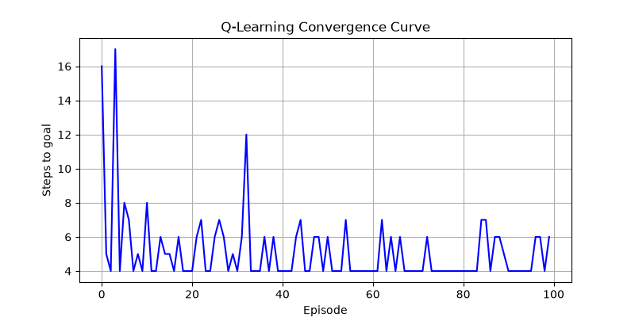

## Q-Learning GridWorld

## About the Project

This project explores how an agent can learn to make decisions, using reinforcement learning in a simple 1D Grid World built in Python. It has three parts:

1. **Q-learning**: a model-free agent that learns from trial and error.
2. **Value iteration**: a model-based method that computes the exact state values, for comparison.
3. **Energy extension**: an agent driven by an internal energy need instead of a goal reward.

## Concepts Demonstrated

- Reinforcement Learning
- Q-learning (model-free)
- Markov Decision Processes (MDPs)
- The Bellman equation
- Epsilon-greedy action selection
- Exploration and exploitation
- Value iteration (model-based planning)
- Homeostatic (need-driven) reward

## Files

- q_learning.py: Q-learning, learning curve and value iteration
- energy_extension.py: the energy-driven agent
- learning_curve.png: learning curve from the Q-learning run

## Part 1: Q-Learning

The environment has five states (0 to 4). The agent starts at state 0 and must reach the goal at state 4. It moves left or right, and learns using a reward signal, a learning rate, a discount factor and an exploration rate. After 100 training episodes, the agent learns a route from the start to the goal.

### Learning Curve

The plot shows how many steps the agent needs to reach the goal in each episode. The number of steps falls as the agent learns, then levels off near the shortest path. Occasional longer episodes come from random exploration.

## Part 2: Value Iteration

Value iteration is a model-based method. It uses the environment's rules directly and applies the Bellman equation until the values stop changing. There is no trial and error. Result:

Value iteration result: [ 4.58  6.2   8.   10.    0.  ]

These exact state values can be compared with the maximum Q-values the Q-learning agent learns.

## Part 3: Energy Extension

In energy_extension.py, the agent has no goal. It has a body-like internal need instead.

- Positions 0 to 4, with food at position 4.
- Energy from 0 to 5. Every step costs 1 energy.
- Being at the food position restores 3 energy, up to the maximum.
- If energy reaches 0 the agent "dies" and is penalised.
- The reward is based only on how close energy is to full.
- The agent can move left, move right or stay, and learns with Q-learning over 3,000 episodes from random starting positions and energy levels.

### Results

Learned action for each (position, energy):
energy ->  1       2       3       4       5
pos 0:   stay    right   stay    right   right
pos 1:   left    right   right   right   right
pos 2:   right   right   right   right   right
pos 3:   right   right   right   right   right
pos 4:   right   right   right   right   right

Energy over time in a test run from position 0 with full energy:

Energy over time: [5, 4, 3, 2, 4, 5, 5, 5, 5, 5, 5, 5, 5, 5, 5, 5]

The agent learns to walk to the food and stay there, keeping its energy near full. Its behaviour comes from an internal need instead of a goal location. Some low-energy states far from the food show arbitrary actions because the agent cannot reach food in time from there.

## Limitations

These are small tabular demonstrations in tiny environments. They show the core ideas, not results at research scale, and they do not use neural networks or physics-based environments.

## Technologies

Python, NumPy, Matplotlib

## Run the Project

pip install numpy matplotlib
python q_learning.py
python energy_extension.py

## Learning Outcome

This project helped me practise how an agent learns from rewards, how model-free and model-based methods relate, and how behaviour can emerge from an internal need.
